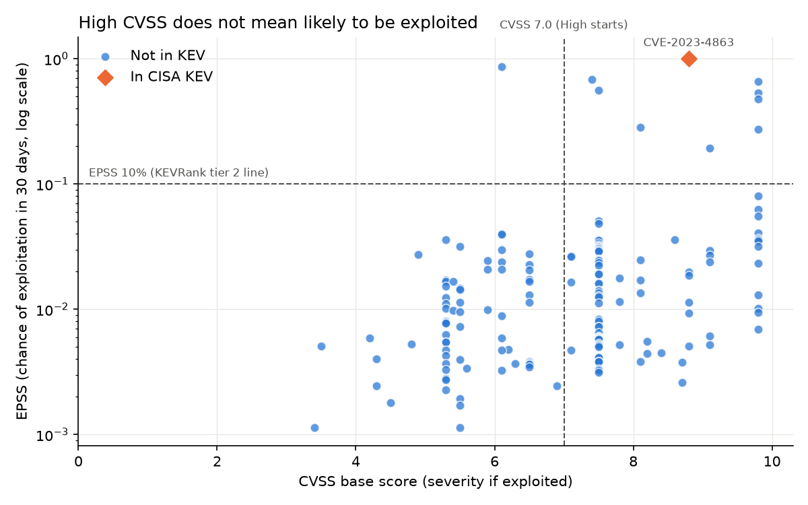

# KEVbyRank

Rank a list of CVEs by evidence of real world exploitation instead of CVSS severity alone.

**Finding on a sample scan:** Of 173 findings in a 2019 era Python stack, a "patch every High and Critical" policy flags 103. KEVRank flags 10 as urgent. One of those 10 is a Medium (CVSS 6.1) with an 87% chance of exploitation, which the CVSS policy would never reach. The only finding known to be exploited, CVE-2023-4863, is rated High, not Critical.

## Why

Most of the patch queues are sorted by CVSS. CVSS measures how bad a vulnerability would be if it were exploited. It does not measure whether anyone is exploiting it. KEVRank adds two signals that do.

| Signal | Source | What it says |
| --- | --- | --- |
| KEV | CISA Known Exploited Vulnerabilities catalog | This CVE has been exploited in the wild |
| EPSS | FIRST Exploit Prediction Scoring System | Estimated probability of exploitation in the next 30 days |
| CVSS | NIST National Vulnerability Database | Severity if exploited, from 0 to 10 |

US federal policy has moved the same way. CISA's Binding Operational Directive 26-04 (June 2026) tells federal civilian agencies to set patch deadlines by risk, with KEV listing as one of four risk factors.

## How it ranks

| Tier | Rule | Meaning |
| --- | --- | --- |
| 1 | In CISA KEV | Known exploited. Patch first. |
| 2 | EPSS at or above 0.10 | Likely to be exploited. |
| 3 | CVSS at or above 7.0 | Severe, but exploitation is unlikely for now. |
| 4 | Everything else | Routine. |

Inside a tier, findings are sorted by EPSS, then by CVSS.

## Usage

    python3 -m venv .venv
    source .venv/bin/activate
    pip install -r requirements.txt

    # scan a requirements file, then rank the findings
    pip-audit -r data/legacy-requirements.txt --no-deps --disable-pip -f json -o data/audit.json
    python kevrank.py data/audit.json

    # or rank a plain list of CVE IDs, one per line
    python kevrank.py data/sample-cves.txt

    # compare with a CVSS-only order and draw the chart
    python analysis.py

    # run the tests
    python -m pytest

NVD limits requests to 5 per 30 seconds. Set a free API key in the `NVD_API_KEY` environment variable to go ten times faster. Scores are cached in `cache/`.

## Results

Input: a `pip-audit` scan of 16 common Python packages pinned to early-2019 versions (`data/legacy-requirements.txt`). This is a simulated legacy stack, not a real system. Data pulled on November 15, 2026.

- Findings analysed: 173
- CVSS Critical (9.0+): 23. Of those, 4 (17%) have EPSS under 1%.
- CVSS High or Critical (7.0+): 103. Of those, 39 (38%) have EPSS under 1%.
- In CISA KEV: 1 (not CVSS Critical: 1).
- Urgent under KEVRank (tier 1 or 2): 10, against 103 under a "patch every High and Critical" policy.
- Urgent findings that are not CVSS Critical: 5. Below CVSS High: 1.

Pillow alone accounts for 80 of the 173 findings, so one upgrade closes 46% of the list.

## Limitations

- EPSS is a model's estimate, not a fact, and it changes daily. These results are a snapshot.
- KEV lists only what CISA has confirmed. A CVE missing from KEV may still be exploited.
- - The 0.10 EPSS line is my choice, not some standard. I tested 0.05, 0.10 and 0.20 on this scan: the urgent list was 14, 10 and 9 findings. No finding scored between 0.08 and 0.19, so 0.10 sits in a natural gap. It can be changed with `--epss-threshold`.
- The tool knows nothing about the asset. BOD 26-04 also asks whether a system is publicly exposed. KEVRank only sees the CVE.
- CVSS scores come from NVD, preferring v3.1. A few CVEs have only v2 or v4 scores, which are not exactly comparable, and some have none.
- pip-audit reports that a package version is affected. It does not show that the vulnerable code is reachable in a given application.
- Advisories without a CVE ID are skipped.
- This is one scan of one stack. The percentages will differ in other environments.

## How this was built

Built over 7 days in November 2026 as a learning project. The project was created alongside Claude and built one step at a time. I had claude help debug, explain new concepts, create tests, and prompted it to write each piece against the live data sources, review every line, and test each piece against the live KEV, EPSS and NVD services and reviewed every line. 

Two things came from running it for real. NVD rate limited my requests and then timed out mid run, which crashed the first version; the retry logic was extended to cover timeouts and dropped connections, and the local cache meant no completed lookups were lost. The EPSS threshold is my decision, made after testing three values on this scan (see limitations).
